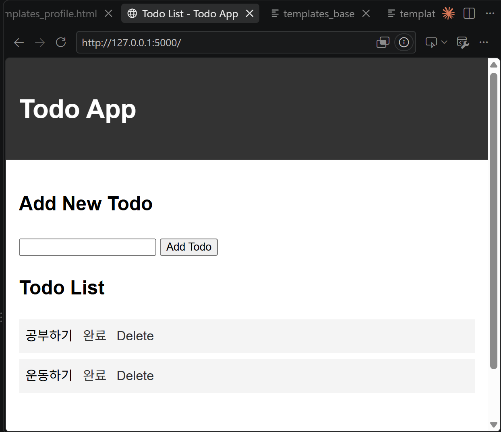
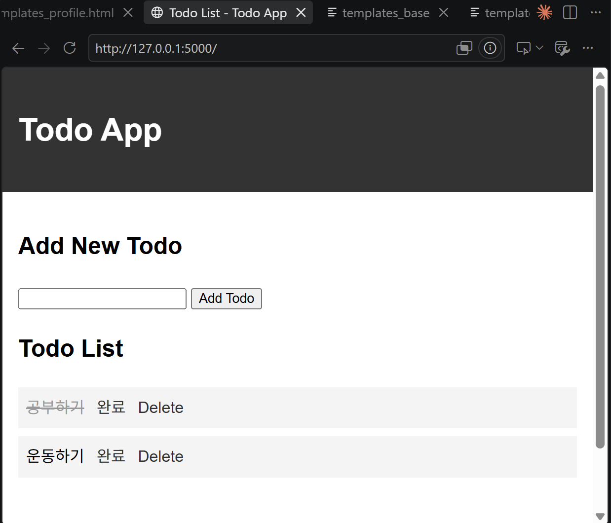
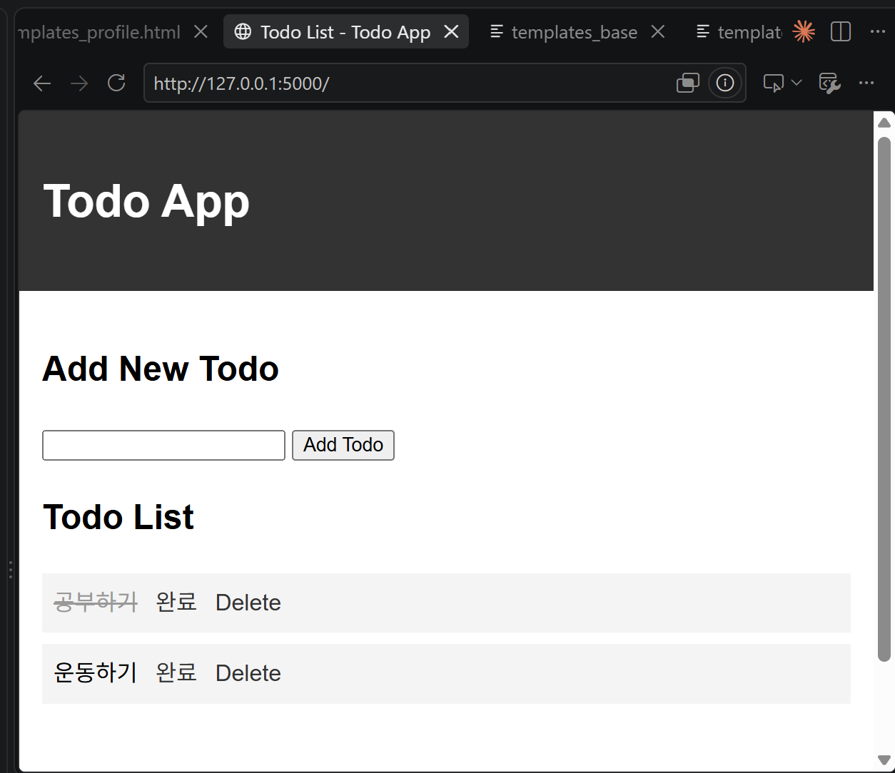

# HW2 — Todo 앱에 완료 체크 기능 추가

## 무엇을 바꿨나

오늘 수업에서 만든 `todo_app`을 복사해서 완료(toggle) 기능을 추가했습니다.

| # | 파일 | 바꾼 내용 |
|---|---|---|
| 1 | `app.py` | `todos`를 글자 리스트 대신 `{'text': ..., 'done': False}` 딕셔너리 리스트로 저장 |
| 2 | `app.py` | `/toggle/<int:index>` 라우트 추가 — `done` 값을 반대로 바꾸고 목록으로 redirect |
| 3 | `templates/index.html` | `{{ todo }}` → `{{ todo.text }}`로 수정, `done`이면 `done` 클래스 적용, [완료] 링크 추가 |
| 4 | `static/style.css` | `.done { text-decoration: line-through; color: #999; }` 추가 |

## 페이지 구성

| 주소 | 메소드 | 하는 일 |
|---|---|---|
| `/` | GET | 할 일 목록 보기 |
| `/` | POST | 할 일 추가 |
| `/toggle/<int:index>` | GET | 완료 상태 반전 |
| `/delete/<int:index>` | GET | 할 일 삭제 |

## 실행 방법

```
cd HW2
flask --debug run
```

`http://127.0.0.1:5000/` 접속

## 실행 화면

① 할 일 두 개가 있는 목록



② 하나를 [완료] 눌러 줄이 그어진 화면



③ 새로고침한 뒤에도 줄이 남아 있는 화면


