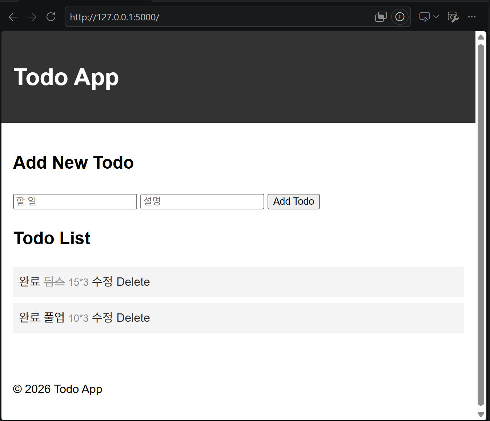
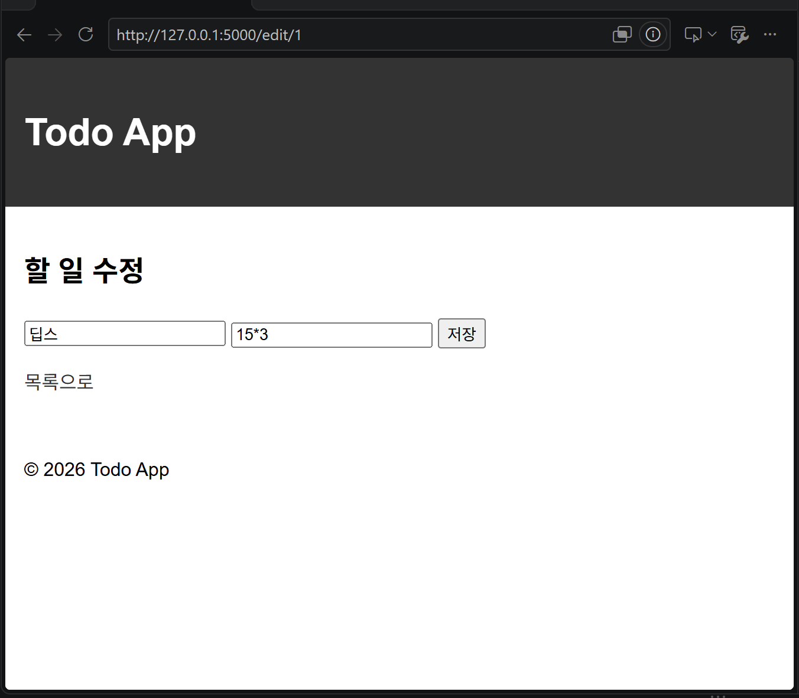
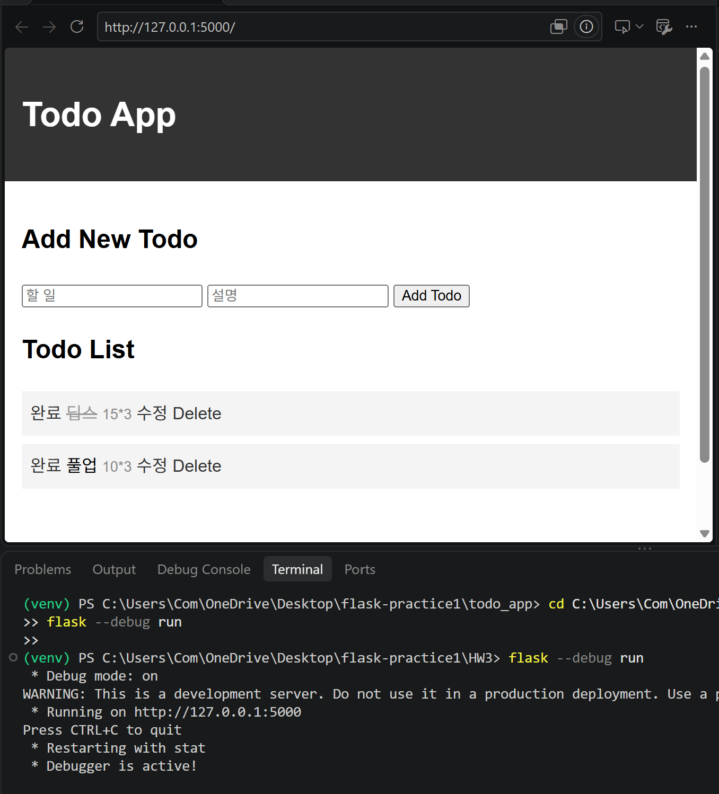

# HW3 — Todo 앱에 수정 기능 더하기

## 무엇을 바꿨나

4장 수업에서 DB 로 옮긴 `todo_app` 을 복사해서 설명 칸과 수정 화면을 추가했습니다.

| # | 파일 | 바꾼 내용 |
|---|---|---|
| 1 | `app.py` | DB 주소를 SQLite(`sqlite:///todo.db`)로 설정. 처음 실행할 때 `db.create_all()` 이 `instance/todo.db` 를 만든다 |
| 2 | `app.py` | `Todo` 모델에 `note = db.Column(db.String(200))` 추가, 추가할 때 `note` 도 함께 저장 |
| 3 | `app.py` | `/edit/<int:id>` 라우트 추가 — GET 이면 수정 화면, POST 면 `text`·`note` 를 고치고 `commit` 한 뒤 목록으로 |
| 4 | `templates/edit.html` | 수정 화면 새로 만듦. 입력칸에 `value="{{ todo.text }}"`, `value="{{ todo.note }}"` 로 지금 값이 들어감 |
| 5 | `templates/index.html` | 설명 입력칸, 목록에 설명 표시, [수정] 링크 추가 |
| 6 | `static/style.css` | `.done`(취소선), `.note`(작고 흐린 글자) 추가 |

## 페이지 구성

| 주소 | 메소드 | 하는 일 |
|---|---|---|
| `/` | GET | 할 일 목록 보기 |
| `/` | POST | 할 일 추가 (할 일 + 설명) |
| `/toggle/<int:id>` | GET | 완료 상태 반전 |
| `/edit/<int:id>` | GET | 수정 화면 |
| `/edit/<int:id>` | POST | 할 일과 설명 수정 |
| `/delete/<int:id>` | GET | 할 일 삭제 |

## 실행 방법

```
cd HW3
flask --debug run
```

`http://127.0.0.1:5000/` 접속. `instance/todo.db` 는 처음 실행할 때 자동으로 만들어집니다.

## 실행 화면

① 목록 화면



② 수정 화면



③ 서버를 껐다 켠 뒤에도 그대로인 목록


