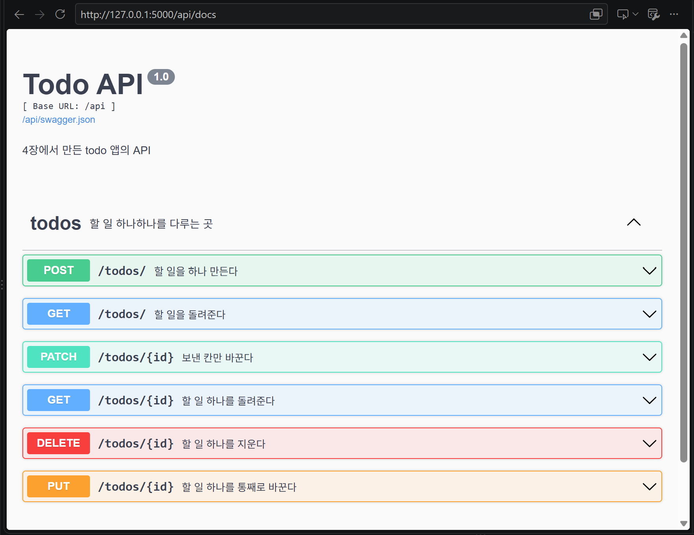
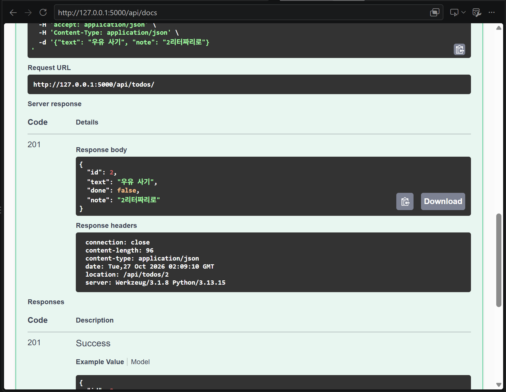
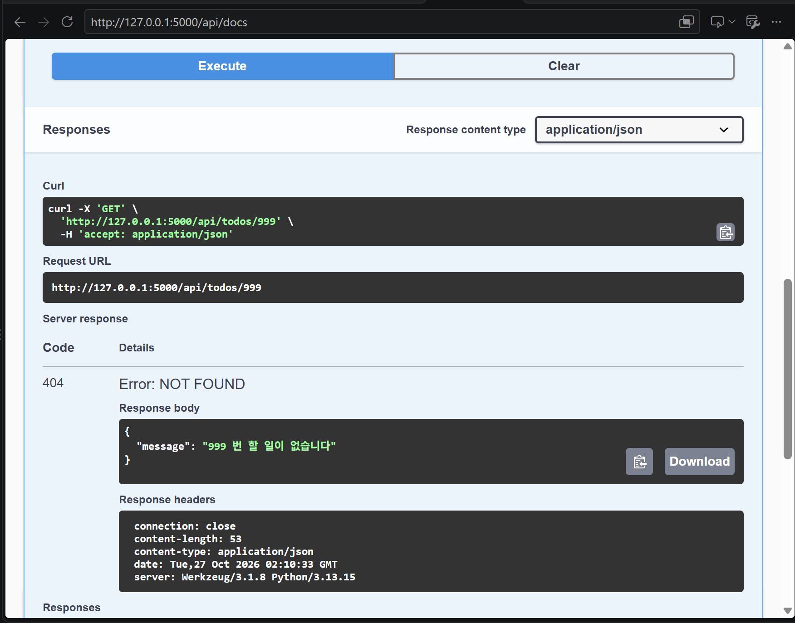

# HW4 : todo 앱에 API 더하기

## 더한 것

- 설명 칸(note)을 API 로도 주고받게 했습니다. 안 보내면 빈 글자(`""`)가 들어갑니다.
- `GET /api/todos/?done=true` 로 완료한 것만, `?done=false` 로 아직 안 한 것만 골라 받게 했습니다. 안 붙이면 전부 돌려줍니다.
- `test_api.py` 에 테스트 8개를 적었습니다. 테스트는 메모리 DB 를 써서 `instance/todo.db` 를 건드리지 않습니다.

## API

| 메소드 | 주소 | 하는 일 | 성공 |
|---|---|---|---|
| GET | `/api/todos/` | 할 일 전부 (`?done=true/false` 로 거르기) | 200 |
| POST | `/api/todos/` | 할 일 만들기 | 201 |
| GET | `/api/todos/<id>` | 할 일 하나 | 200 |
| PUT | `/api/todos/<id>` | 통째로 바꾸기 | 200 |
| PATCH | `/api/todos/<id>` | 보낸 칸만 바꾸기 | 200 |
| DELETE | `/api/todos/<id>` | 지우기 | 204 |

없는 번호는 `404 {"message": "N 번 할 일이 없습니다"}` 를 돌려줍니다.

## 실행하는 법

    pip install -r requirements.txt
    flask --debug run
    화면  http://127.0.0.1:5000/
    문서  http://127.0.0.1:5000/api/docs

## 테스트

    python -m unittest

## 화면

### 1. 주소 여섯 줄이 모두 보이는 문서

### 2. note 를 넣어 만들었더니 201 이 온 모습

### 3. 없는 번호를 불렀더니 404 가 온 모습

